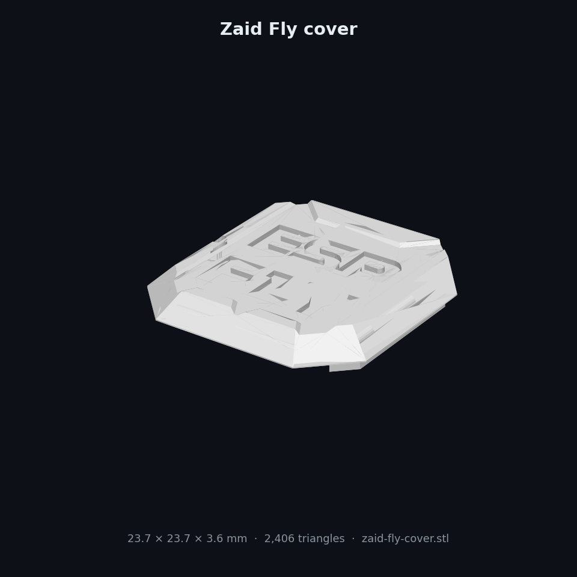
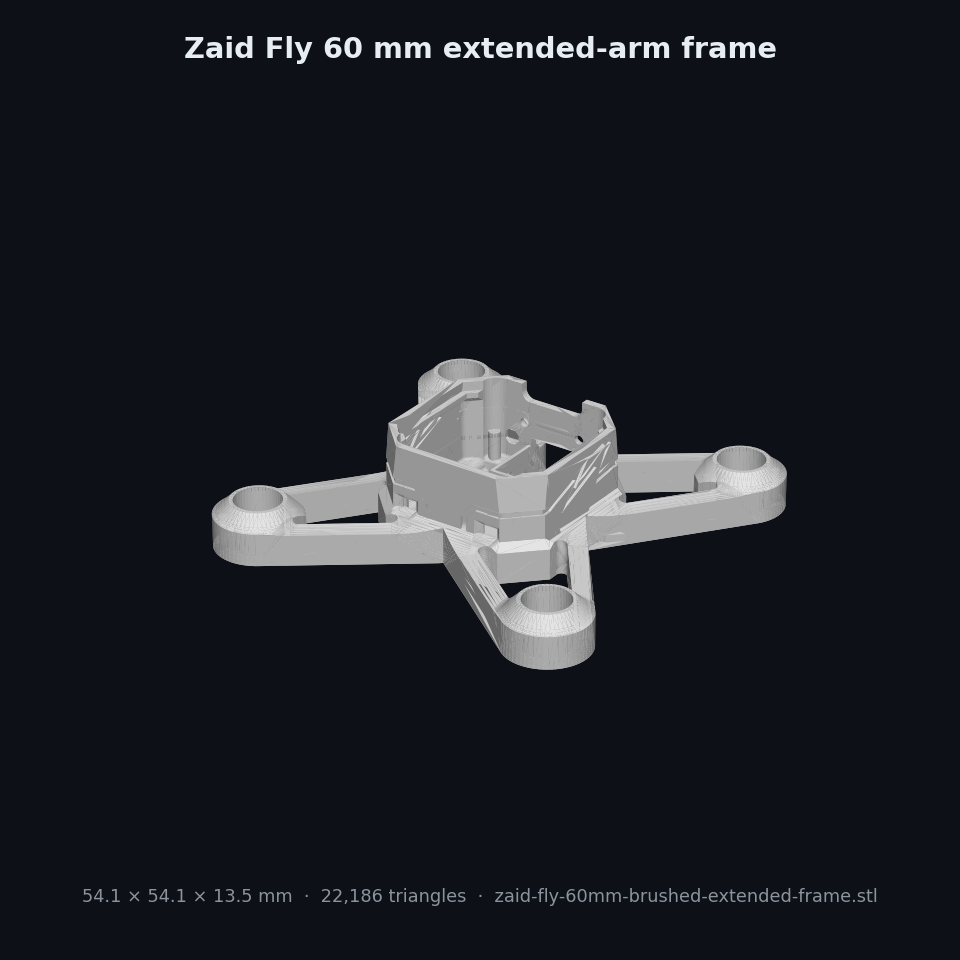

# Zaid Fly 3D-printed parts

  

| STL | STEP | Use |
|---|---|---|
| `stl/zaid-fly-frame.stl` | `step/zaid-fly-frame.step` | **Main swarm frame**, 47.8 × 47.8 × 13.5 mm, rings for 720 motors |
| `stl/zaid-fly-cover.stl` | `step/zaid-fly-cover.step` | Top cover (snaps on, protects the PCB) |
| `stl/zaid-fly-camera-cover.stl` | `step/zaid-fly-camera-cover.step` | Cover with a camera window for the XIAO ESP32-S3 Sense |
| `stl/zaid-fly-60mm-brushed-extended-frame.stl` | `step/zaid-fly-60mm-brushed-extended-frame.step` | Longer arms for larger props |
| `stl/zaid-fly-brushless-extended-frame.stl` | `step/zaid-fly-brushless-extended-frame.step` | Extended frame for small brushless motors |

For the swarm I printed **20× frame + 20× cover**, plus spares, because frames are what break in crashes.

## Print settings

PLA or PETG · 0.12 mm layers · 3–4 walls · 30% gyroid · no supports (print the cover upside down) · about 6 sets per plate.

## Credit

These models are based on the **ESP-FLY** micro-drone frame by **Max Imagination**, renamed to Zaid Fly for this project. The original design and its license belong to its author. If you publish or remix them, credit the original.
