# Zaid Fly: a 20-drone ESP32 swarm

<p align="center">
  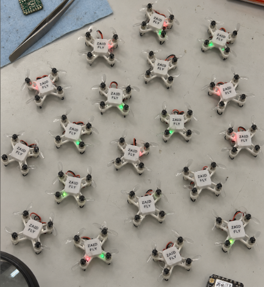
</p>

<p align="center">
  <b>20 palm-sized drones · 1 ground station · 1 radio frame per update · no noticeable lag</b><br>
  Custom PCB · hand-soldered · 3D-printed frames · ESP-NOW swarm firmware
</p>

---

## The goal

I wanted to fly **20 drones at once from one controller with no delay you can notice**, and have every drone react **at the same instant**, so the swarm moves as one object instead of 20 drones each catching up at their own pace.

Most hobby swarms send one message per drone. With 20 drones the last one hears its command several milliseconds after the first, and every lost packet triggers a retry that adds more delay. I built Zaid Fly around one idea: **put the whole swarm's commands in a single broadcast radio frame.** One frame on the air, 20 drones receive it together, and each one reads its own 8-byte slot.

## What I did

| | |
|---|---|
| **Designed the electronics** | A carrier PCB for the Seeed XIAO ESP32-S3 with an MPU-6050 IMU, four SI2300 MOSFET motor drivers with flyback protection, a battery-sense divider, status LEDs, and headlights and taillights. KiCad files are in [`hardware/`](hardware/). |
| **Ordered the components** | 20 sets of everything plus spares (full list below and in [`hardware/bom/zaid-fly-bom.csv`](hardware/bom/zaid-fly-bom.csv)). |
| **Soldered 20 boards by hand** | 45 parts per board, 900 parts total, including the 4×4 mm QFN IMU. |
| **3D-printed 20 frames and covers** | Frame, cover and alternative frames are in [`3d-models/`](3d-models/). |
| **Wrote the firmware** | A 1 kHz flight controller for every drone and a 200 Hz ground-station radio bridge. Both are in [`firmware/`](firmware/). |
| **Wrote the swarm controller** | PC software for flying with a gamepad, running light shows and measuring latency. It's in [`software/`](software/). |

## Build gallery

| Components for one drone | Schematic |
|---|---|
| 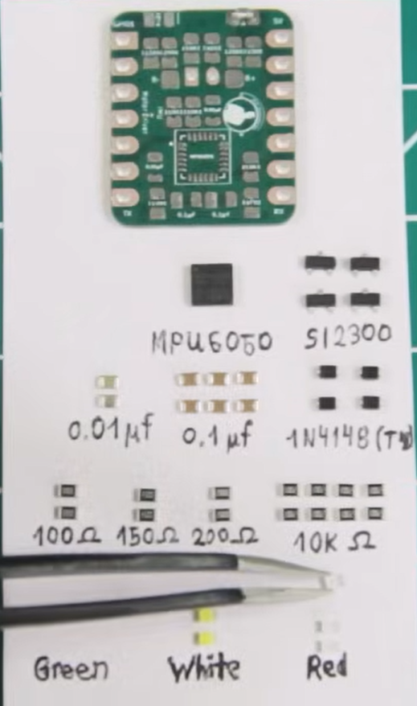 | 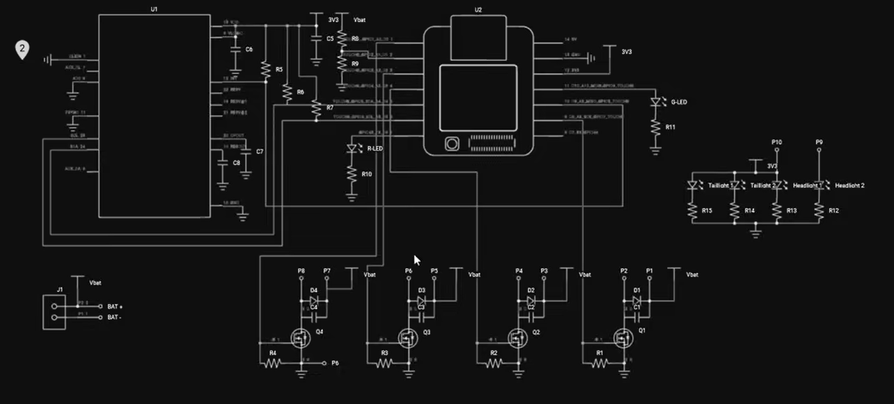 |

| PCB placement | PCB routed (GND pour) |
|---|---|
| 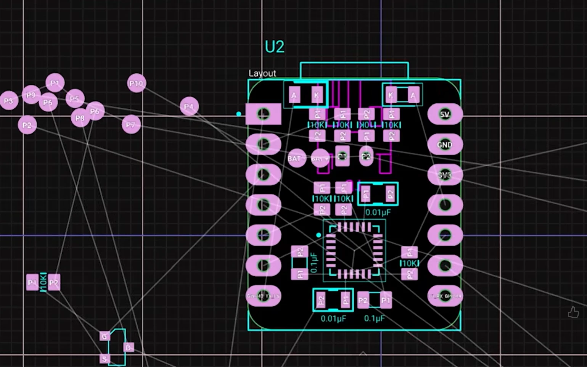 | 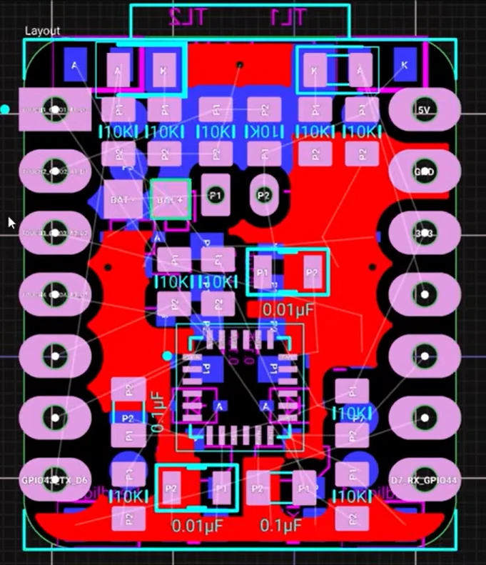 |

| Generated board (top) | Ratsnest from the netlist |
|---|---|
| 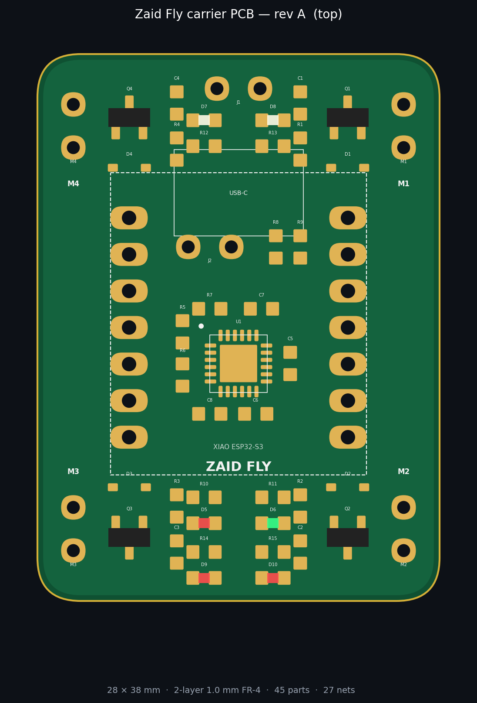 | 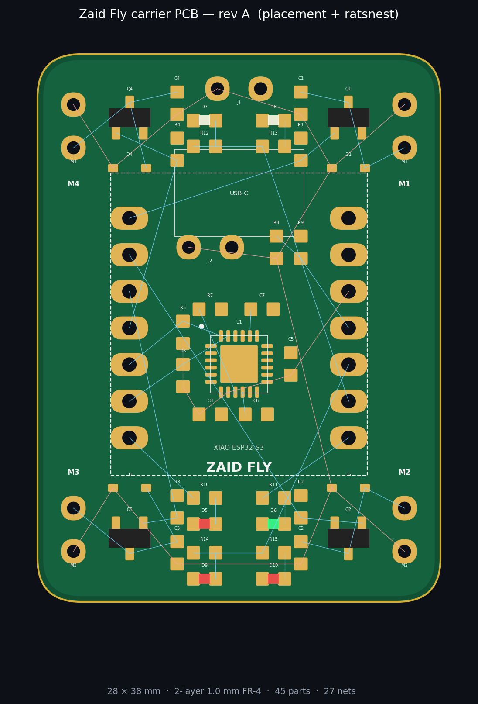 |

| 3D-printed frame | Full assembly |
|---|---|
| 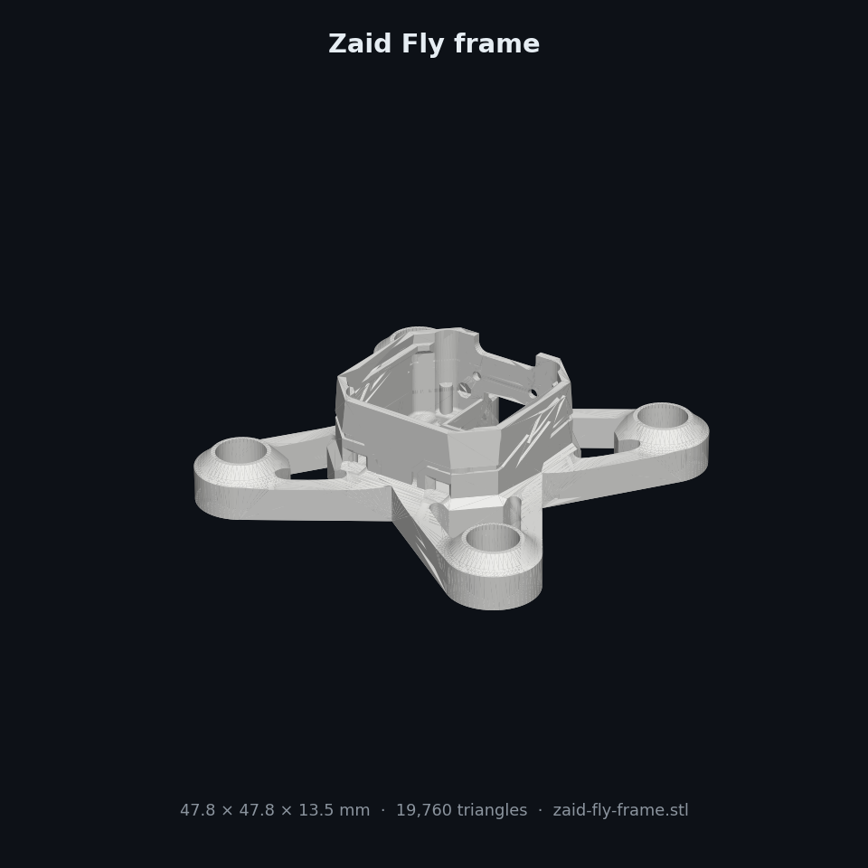 | 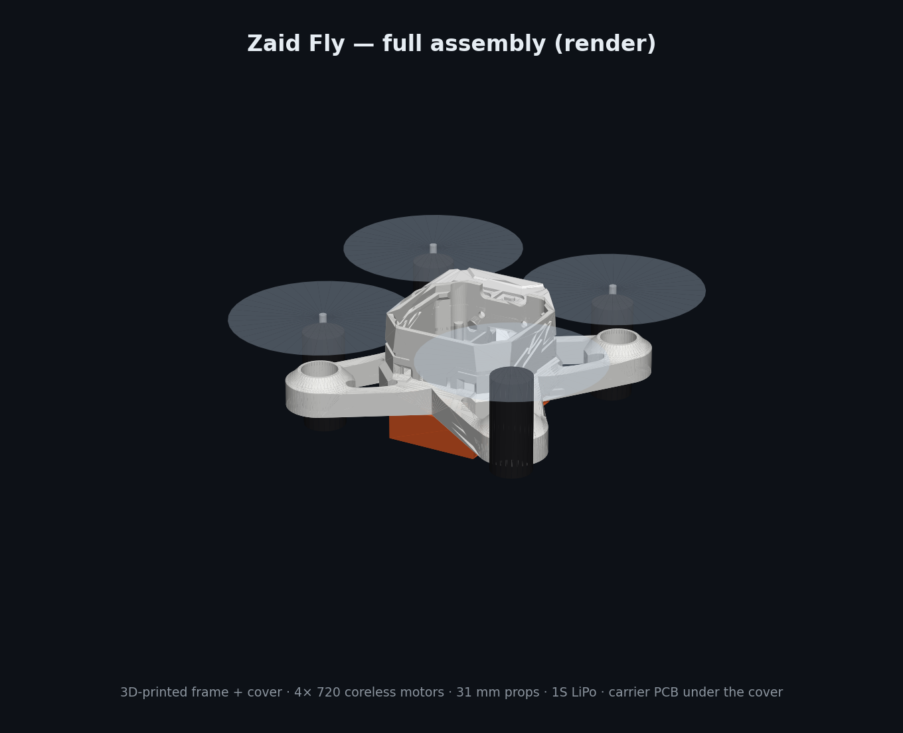 |

<p align="center">
  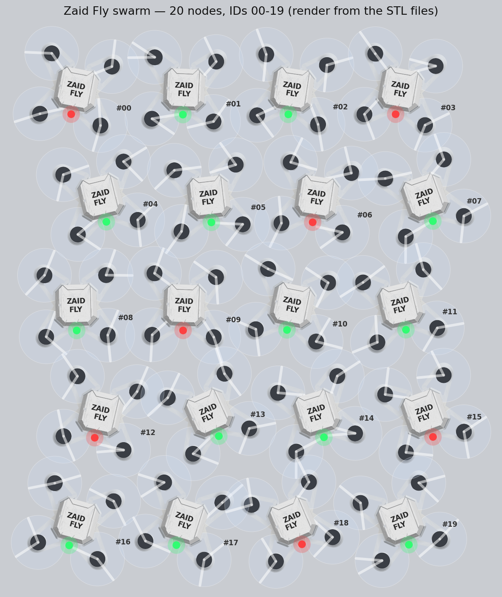<br>
  <i>The 20 nodes, IDs 00–19, rendered from the STL files in this repo.</i>
</p>

---

## How the "no delay" link works

<p align="center">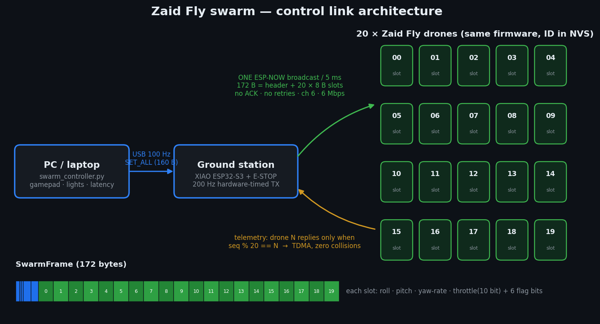</p>

1. **The PC** reads the gamepad and sends the full 20-slot command table over USB at 100 Hz.
2. **The ground station** (an XIAO ESP32-S3) stores the table and broadcasts it on its own **hardware-timed 200 Hz clock**, so timing jitter on the PC side never reaches the drones.
3. **One ESP-NOW broadcast frame** (172 bytes: header plus 20 × 8-byte slots) goes out every 5 ms on a fixed channel at a fixed 6 Mbps PHY rate:
   * **No ACKs and no retries.** A late command is worse than a lost one, and the next frame is only 5 ms away.
   * **Wi-Fi power-save is off** on every node, so the radio never dozes between frames.
   * **All 20 drones hear the same frame at the same instant**, so the swarm stays in sync by construction.
4. **Each drone** copies its slot in the Wi-Fi callback and its **1 kHz control loop** uses it within 1 ms.
5. **Telemetry uses TDMA.** Drone *N* only replies to the frame where `seq % 20 == N`. Each drone reports at 10 Hz, and replies never collide with each other or with the command stream. Every reply echoes the ground station's timestamp, so round-trip time is measured continuously.

<p align="center">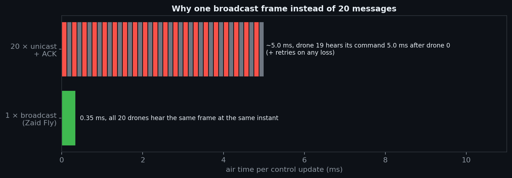</p>
<p align="center">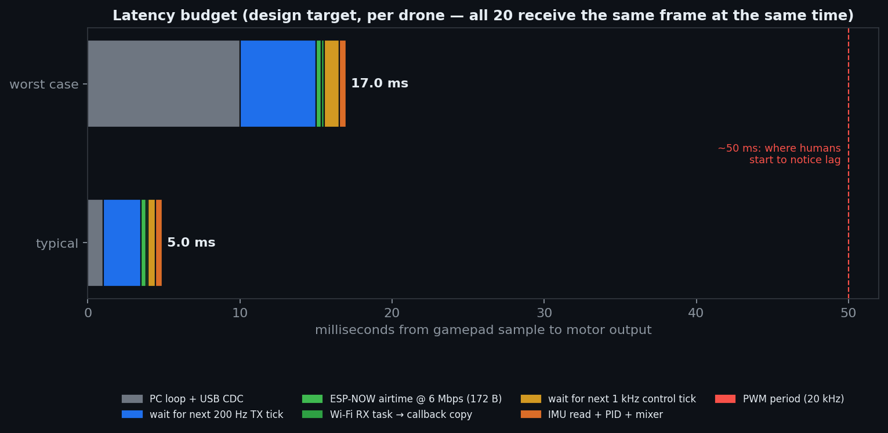</p>

| Stage | Budget |
|---|---|
| PC loop + USB CDC | ≤ 10 ms (typically ~1 ms) |
| Wait for the next 200 Hz TX tick | ≤ 5 ms (2.5 ms average) |
| Airtime, 172 B @ 6 Mbps | ~0.35 ms |
| Wait for the next 1 kHz control tick + compute | ≤ 1.5 ms |
| **Stick to motor (typical / worst case)** | **~5 ms / ~17 ms** |

People start noticing control lag at about 50 ms. The design stays well under that, with the same delay for all 20 drones.

**Measured on my swarm** (run `python software/swarm_controller.py --port COMx --mode latency`):

| Metric | Result |
|---|---|
| Median round-trip time (GS → drone → GS) | _fill in_ |
| 95th-percentile RTT | _fill in_ |
| Lost frames per drone (indoor, 3 m) | _fill in_ |
| Worst control-loop time | _fill in_ |

More detail: [`docs/LOW_LATENCY.md`](docs/LOW_LATENCY.md)

---

## Hardware

### Pin map (XIAO ESP32-S3)

| XIAO | GPIO | Function |
|---|---|---|
| D0–D3 | 1–4 | Motor 1–4 MOSFET gates (20 kHz PWM) |
| D4 / D5 | 5 / 6 | I²C SDA / SCL → MPU-6050 (10k pull-ups) |
| D6 | 43 | Red status LED |
| D7 | 44 | Green status LED |
| D8 | 7 | Headlights (2× white) |
| D9 | 8 | Taillights (2× red) |
| D10 | 9 | Battery sense (VBAT ÷ 2) |

Motor layout (top view, front up): **M4** front-left CW · **M1** front-right CCW · **M3** rear-left CCW · **M2** rear-right CW.

### Bill of materials

**Per drone** (the electronics come from [`zaid-fly-bom.csv`](hardware/bom/zaid-fly-bom.csv), which is generated from the netlist):

| Qty | Part | Notes |
|---|---|---|
| 1 | Seeed Studio XIAO ESP32-S3 | MCU and radio. Its built-in charger and LDO run it from the LiPo |
| 1 | Zaid Fly carrier PCB | 28 × 38 mm, 2-layer, 1.0 mm FR-4 |
| 1 | MPU-6050 (QFN-24) | 6-axis IMU |
| 4 | SI2300 N-MOSFET (SOT-23) | Low-side motor switches |
| 4 | 1N4148WS (SOD-323) | Motor flyback diodes |
| 6 | 0.1 µF 0603 | 4 across the motors, MPU VDD and REGOUT |
| 2 | 0.01 µF 0603 | MPU CPOUT and VLOGIC |
| 9 | 10 kΩ 0603 | Gate pull-downs, I²C pull-ups, AD0, battery divider |
| 2 / 2 / 2 | 100 Ω / 150 Ω / 200 Ω 0603 | LED resistors |
| 3 / 1 / 2 | Red / green / white 0603 LEDs | Status, taillights, headlights |
| 4 | 720 coreless brushed motors (7 × 20 mm) | 2 CW + 2 CCW |
| 4 | 31 mm propellers | 2 A + 2 B |
| 1 | 1S 3.7 V LiPo, ~250–300 mAh, JST-PH 2.0 | |
| 1 | 3D-printed frame + cover | [`3d-models/stl`](3d-models/stl) |
| 2 | 1×7 low-profile pin headers | Stack the XIAO above the SMD parts |

**For the whole project** (20 drones plus the ground station):

| Qty | Item |
|---|---|
| 21 | XIAO ESP32-S3 (20 drones + 1 ground station, which should have the external U.FL antenna) |
| 20 (+5 spare) | Carrier PCBs |
| 20 (+2) | MPU-6050 |
| 80 (+10) | SI2300, 1N4148WS |
| 120 / 40 | 0.1 µF / 0.01 µF capacitors |
| 180 / 40 / 40 / 40 | 10k / 100 Ω / 150 Ω / 200 Ω resistors |
| 60 / 20 / 40 | Red / green / white LEDs |
| 80 (+8) | 720 coreless motors (40 CW, 40 CCW) |
| 80 (+20) | 31 mm props (40 A, 40 B) |
| 20 (+10) | 1S LiPo batteries + a multi-port 1S charger |
| ~250 g | PLA or PETG for 20 frames and covers |
| 1 | Big latching E-STOP button for the ground station |
| | Solder paste, flux, hot-air station, fine-tip iron, tweezers, magnifier, 30 AWG silicone wire |

---

## 3D-printed parts

| File | What it is |
|---|---|
| [`zaid-fly-frame.stl`](3d-models/stl/zaid-fly-frame.stl) | Main frame used for the swarm (47.8 × 47.8 mm) |
| [`zaid-fly-cover.stl`](3d-models/stl/zaid-fly-cover.stl) | Top cover with the **ZAID FLY** label |
| [`zaid-fly-camera-cover.stl`](3d-models/stl/zaid-fly-camera-cover.stl) | Cover variant with a camera mount (XIAO ESP32-S3 Sense) |
| [`zaid-fly-60mm-brushed-extended-frame.stl`](3d-models/stl/zaid-fly-60mm-brushed-extended-frame.stl) | Extended-arm frame for bigger props |
| [`zaid-fly-brushless-extended-frame.stl`](3d-models/stl/zaid-fly-brushless-extended-frame.stl) | Extended-arm frame for brushless motors |

STEP files for editing are in [`3d-models/step/`](3d-models/step/). Print settings and credits are in [`3d-models/README.md`](3d-models/README.md).

---

## Repository layout

```
zaid-fly-swarm/
├── firmware/
│   ├── common/swarm_protocol.h     # radio + USB protocol shared by every node
│   ├── drone/                      # flight controller (PlatformIO, XIAO ESP32-S3)
│   └── ground_station/             # USB <-> ESP-NOW 200 Hz broadcaster
├── software/swarm_controller.py    # PC: gamepad / lights / latency modes
├── hardware/
│   ├── kicad/                      # KiCad 8 project, symbols, footprints, netlist
│   ├── bom/zaid-fly-bom.csv
│   └── tools/generate_kicad.py     # netlist + placement source of truth
├── 3d-models/{stl,step}/           # frame and cover files
├── docs/                           # build guide, latency notes, images
└── tools/render_images.py          # regenerates the renders in docs/images
```

## Quick start

```bash
# 1. Flash every drone (same binary for all 20)
cd firmware/drone && pio run -t upload
# 2. Give each drone its swarm ID (0-19): open the serial monitor and type   id 7
pio device monitor
# 3. Flash the ground station
cd ../ground_station && pio run -t upload
# 4. Run the swarm
cd ../../software && pip install -r requirements.txt
python swarm_controller.py --port COM5 --mode lights     # check all 20 nodes respond
python swarm_controller.py --port COM5 --mode latency    # measure the link
python swarm_controller.py --port COM5 --mode gamepad    # fly
```

The full step-by-step guide (ordering, soldering, printing, assembly, tuning, and bringing up all 20 drones) is in **[`docs/BUILD_GUIDE.md`](docs/BUILD_GUIDE.md)**.

## Safety features

* **E-STOP**: SPACE, gamepad **B**, Ctrl+C or the hardware button on the ground station kills every motor in the swarm. The hardware stop latches until reboot.
* **Link loss**: if a drone hears nothing for 150 ms, it levels out and ramps throttle to zero over 2.5 s.
* **PC crash**: the ground station stops transmitting after 300 ms, so every drone runs its own failsafe landing.
* **Crash detection**: tilt beyond 70° cuts the motors.
* **Arming**: a drone only arms with a live link and throttle at the bottom.
* **Battery compensation**: motor output is scaled for battery sag, so a drone on a 3.6 V pack responds the same as one on a fresh 4.2 V pack.

## Credits

* The frame and cover are based on the open-source **ESP-FLY** design by **Max Imagination**, renamed for this build. Please respect the original license of the 3D models.
* Reference build video: <https://www.youtube.com/watch?v=V_mZsiZcy7s>
* Seeed Studio XIAO ESP32-S3, Espressif ESP-NOW, and the TDK InvenSense MPU-6050 datasheet.

## License

Firmware, software and hardware sources are under the [MIT License](LICENSE). The 3D models stay under their original author's license.
